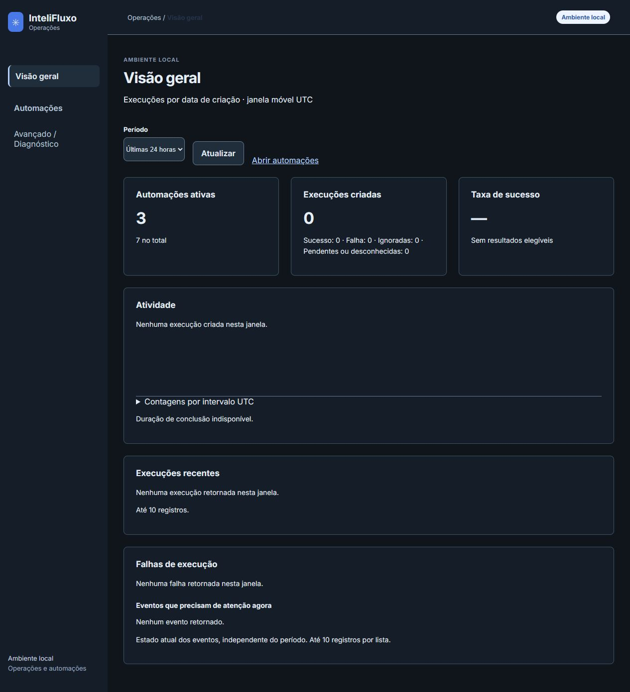
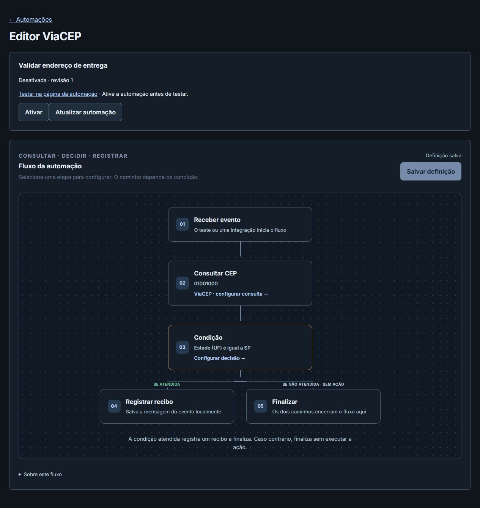
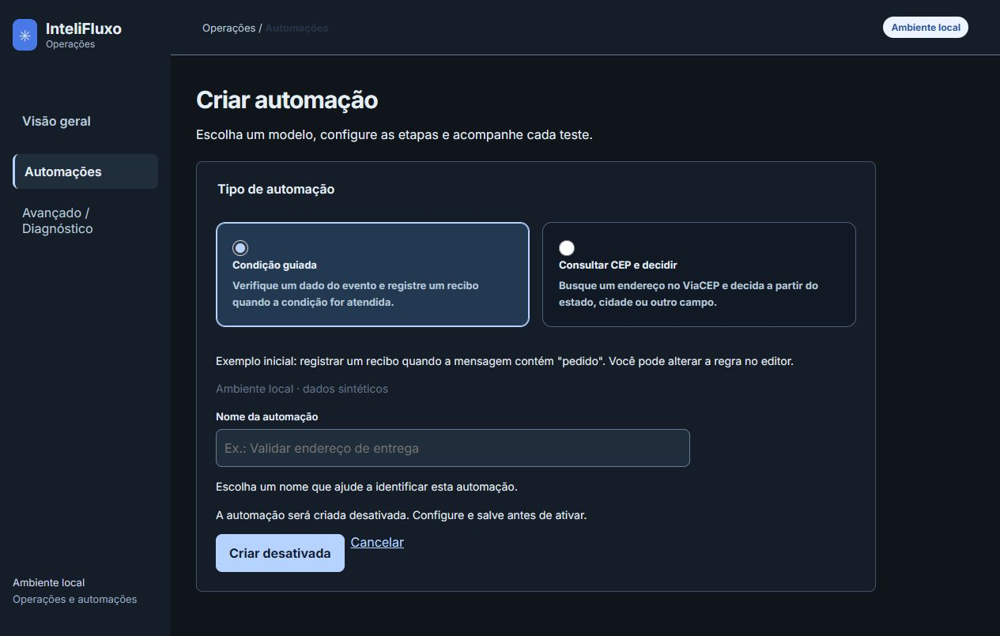
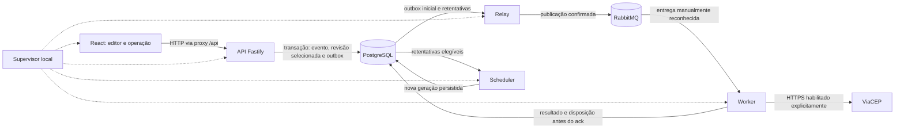
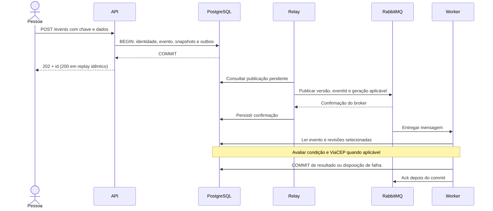
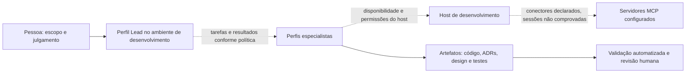

# InteliFluxo

**Automações visuais sobre processamento assíncrono de eventos — com contratos explícitos, idempotência e decisões rastreáveis.**


O InteliFluxo é um laboratório de engenharia para um problema concreto: **como aceitar um evento uma única vez por identidade, executá-lo de forma assíncrona e explicar o resultado quando há duplicação, falha ou mudança de configuração?**

O projeto combina uma aplicação executável com uma experiência documentada de desenvolvimento assistido por IA. Demonstra arquitetura orientada a eventos, desenho de contratos, integração frontend/backend e validação de falhas. Os perfis de agentes e a configuração MCP encontrados pertencem ao **ambiente de desenvolvimento**; o produto atual não executa agentes LLM nem hospeda um servidor MCP.

[Demonstração](#demonstração-real) · [Arquitetura](#arquitetura-da-aplicação) · [Agentes e MCP](#ia-agentes-e-mcp) · [Executar](#executar-localmente) · [Validação](#validação) · [Limitações](#limitações-e-próximos-passos)

**Formulários conectados:** [crie vários formulários pela interface](docs/forms.md), publique o link local e dispare uma automação com o CEP de cada resposta. A opção **Conectar Google Forms** permite cadastrar links e mapeamentos futuros e gerar um script autenticado; requer autorização no Google e entrada HTTPS pública configuradas pelo usuário.

## O que foi construído

| Capacidade                  | Implementação e evidência                                                                                                                                                                |
| --------------------------- | ---------------------------------------------------------------------------------------------------------------------------------------------------------------------------------------- |
| Aceitação idempotente       | Identidade `(scope, idempotencyKey)`, comparação de conteúdo JSONB e criação transacional de evento/outbox: [accept.ts](backend/src/accept.ts)                                           |
| Configuração reprodutível   | Revisões persistidas e execução vinculada à revisão selecionada na aceitação: [automations.ts](backend/src/automations.ts)                                                               |
| Automação visual            | Templates de condição e ViaCEP, edição de etapas, validação e conflitos de revisão: [WorkflowBuilder](frontend/src/WorkflowBuilder.tsx), [ViaCepBuilder](frontend/src/ViaCepBuilder.tsx) |
| Decisão tipada              | Operadores sobre texto, número, booleano, nulo e existência; distinção entre ausente e nulo: [condition.ts](backend/src/condition.ts)                                                    |
| Consulta externa controlada | CEP fixo ou dado do evento, transporte HTTPS restrito ao ViaCEP, timeout e projeção validada: [transporte](backend/src/viacep-transport.ts)                                              |
| Falhas e retentativas       | Classificação, estado persistido, elegibilidade e geração de publicação: [retry-policy.ts](backend/src/retry-policy.ts), [scheduler.ts](backend/src/scheduler.ts)                        |
| Operação local              | Supervisor, prontidão, processos separados e orçamento finito de reinicialização: [runtime-supervisor.ts](backend/src/runtime-supervisor.ts)                                             |
| Inspeção pela interface     | Visão geral, teste com dados tipados, recuperação da mesma solicitação e histórico: [TestEventPanel](frontend/src/TestEventPanel.tsx)                                                    |

**Competências evidenciadas:** arquitetura distribuída, consistência transacional, sistemas assíncronos, contratos versionados, testes de falha, integração com serviço externo e uso crítico de IA no desenvolvimento. Integração de modelos em runtime e avaliação de qualidade de agentes continuam sendo evoluções, não resultados implementados.

## Demonstração real

**Consulta ViaCEP funcionando:** [passo a passo e resultado real](docs/demo/README.md) · [vídeo guiado de 53 segundos](docs/demo/viacep-passo-a-passo.mp4). O fluxo consulta um CEP, compara a UF e registra um recibo local.

Capturas da aplicação local em execução, em 17/11/2026. Os dados são de demonstração e as contagens representam a janela consultada, não um benchmark.

### Visão geral



### Configuração visual de consulta e decisão



### Criação guiada



Veja a [origem e o alcance das capturas](docs/assets/screenshots/README.md). Não há interface de conversa com agentes no produto; nenhuma imagem representa uma capacidade de IA inexistente.

## Arquitetura da aplicação



O supervisor gerencia processos; ele não é um agente de IA. PostgreSQL registra decisões duráveis e RabbitMQ transporta entregas. A UI distingue aceitação, publicação e conclusão. O recibo local básico do evento e o resultado de cada automação são registros distintos; uma condição falsa pode ignorar a ação da automação sem eliminar o recibo básico.

### Fluxo de execução



Uma queda entre confirmação do broker e atualização do outbox pode causar reentrega. O desenho trata essa possibilidade; **não promete entrega exatamente uma vez** nem efeito externo exatamente uma vez.

### Decisões que merecem leitura

| Decisão                                        | Problema resolvido                                                 | Custo ou limite                                          |
| ---------------------------------------------- | ------------------------------------------------------------------ | -------------------------------------------------------- |
| Evento e outbox na mesma transação             | Evitar aceite sem intenção de publicação                           | Publicação ainda pode ser duplicada                      |
| Revisão fixada na aceitação                    | Uma edição posterior não muda o trabalho já aceito                 | Exige manter revisões referenciadas                      |
| Grafos v2/v3 com topologia restrita            | Manter contratos verificáveis e execução previsível                | Não é um motor DAG genérico                              |
| Observação ViaCEP persistida                   | Reutilizar observação válida nos caminhos previstos de retentativa | Não equivale a cache global ou transação com o provedor  |
| Escrita e execução externa com gates separados | Revisar definição antes de permitir efeito de rede                 | Configuração explícita e compatibilidade entre processos |
| Teste com solicitação recuperável              | Evitar um novo evento após resposta incerta                        | Registro de sessão não coordena múltiplas abas           |

Os diagramas atualizam a representação textual dos [ADRs 0003](docs/adr/0003-conditions-and-decisions.md), [0005](docs/adr/0005-viacep-address-lookup.md) e [0006](docs/adr/0006-no-terminal-local-app-workflow.md). Os ADRs preservam decisões e checkpoints históricos; [o mapa de evidências](docs/portfolio/evidence.md) distingue o estado atual dessas etapas.

## IA, agentes e MCP

Há dois planos diferentes neste case:

| Plano           | O que pode ser comprovado                                                                                                                                                                                                                                     |
| --------------- | ------------------------------------------------------------------------------------------------------------------------------------------------------------------------------------------------------------------------------------------------------------- |
| Aplicação       | React, API, PostgreSQL, RabbitMQ, worker, relay, scheduler e ViaCEP. Sem chamada a modelo LLM ou cliente/servidor MCP identificados em `backend/src` e `frontend/src`.                                                                                        |
| Desenvolvimento | Nove perfis de agentes OpenCode encontrados em outro checkout local do mesmo projeto; responsabilidades, modelos declarados e regras de colaboração preservados como evidência. Configuração MCP legada identificada, sem prova de sessão para cada conector. |

### Agentes de desenvolvimento identificados

Os modelos abaixo são **identificadores literais nos perfis**, não comprovação de disponibilidade, chamada executada ou comparação de desempenho. Os arquivos foram preservados em `docs/evidence/agent-profiles/`; não configuram automaticamente este repositório.

| Agente                                                                 | Responsabilidade declarada                           | Modelo declarado           |
| ---------------------------------------------------------------------- | ---------------------------------------------------- | -------------------------- |
| [InteliFluxo Lead](docs/evidence/agent-profiles/intelifluxo-lead.md)   | Escopo, delegação, integração e evidência de entrega | `openai/gpt-6.1-terra`     |
| [Architect](docs/evidence/agent-profiles/architect.md)                 | Contratos, trade-offs, arquitetura e ADRs            | `openai/gpt-6-astra`       |
| [Designer](docs/evidence/agent-profiles/designer.md)                   | UX/UI, protótipo e handoff em OpenPencil             | `openai/gpt-6.1-sol`       |
| [Backend Engineer](docs/evidence/agent-profiles/backend-engineer.md)   | API, persistência, mensageria e testes               | `openai/gpt-6.1-terra`     |
| [Frontend Engineer](docs/evidence/agent-profiles/frontend-engineer.md) | Interface, estado, acessibilidade e integração       | `openai/gpt-6.1-terra`     |
| [Code Reviewer](docs/evidence/agent-profiles/code-reviewer.md)         | Revisão independente somente leitura                 | `openai/gpt-6.1-terra#low` |
| [QA Engineer](docs/evidence/agent-profiles/qa-engineer.md)             | Estratégia, cenários de falha e regressão            | `openai/gpt-6.1-terra`     |
| [Researcher](docs/evidence/agent-profiles/researcher.md)               | Pesquisa técnica e redução de incerteza              | `openai/gpt-6.1-terra`     |
| [Documentation](docs/evidence/agent-profiles/documentation.md)         | Guias, contratos, ADRs e rastreabilidade             | `openai/gpt-6.1-terra`     |

Cada agente tem [seção individual com entradas, saídas, ferramentas e limites](docs/portfolio/ai-assisted-development.md). O Lead declara lotes fechados de até três especialistas OpenAI, propriedade exclusiva de arquivos e consolidação antes do próximo lote. Isso documenta uma **política de orquestração**, não um scheduler multiagente implementado no backend.

### MCP: integração de ferramentas no ambiente de desenvolvimento

A configuração legada contém entradas para GitHub, Context7, OpenPencil, Figma, draw.io e Penpot. Essas entradas são inventário de intenção/configuração, não seis integrações validadas. Há incompatibilidades de escopo: o perfil do Lead escolhe OpenPencil e exclui Figma como dependência, enquanto a configuração ainda declara Figma. A documentação registra essa divergência em vez de tratar ambos como partes necessárias do produto.



Este diagrama mostra responsabilidades e conexões **declaradas**, não um trace de execução. A chamada de especialista é um recurso do host; não é automaticamente uma chamada MCP. MCP conecta ferramentas; não é RAG. Não foi identificada implementação de RAG no runtime atual.

### Desenvolvimento assistido por IA

O histórico de trabalho desta entrega inclui inspeção de código, implementação de UX/UI, integração de contratos, diagnóstico de testes, configuração do runtime e redação técnica com auxílio de IA. O usuário definiu a prioridade de UX/UI, exigiu funcionamento real e autorizou a consulta externa ao ViaCEP separadamente. Código produzido por IA foi submetido a testes, tipagem, lint e build; a origem do código não foi usada como selo de qualidade.

Os perfis pedem revisão independente para trabalho crítico, mas sua existência não prova que cada alteração recebeu essa revisão. Também não há log completo de chamadas, custo, tokens ou autoria por agente. [Processo, aprendizados e lacunas](docs/portfolio/ai-assisted-development.md).

## Tecnologias

| Camada         | Tecnologia verificada                            | Uso                                                                   |
| -------------- | ------------------------------------------------ | --------------------------------------------------------------------- |
| Linguagem      | TypeScript 5.9                                   | Contratos e implementação frontend/backend                            |
| Runtime        | Node.js 24, tsx 4.23                             | Processos e execução TypeScript                                       |
| Interface      | React 19.2, React Flow 12.12, Vite 7.3           | Operação e editor visual; ViaCEP usa etapas guiadas                   |
| API            | Fastify 5.12                                     | Rotas HTTP e validação de entrada                                     |
| Estado durável | PostgreSQL; driver pg 8.23                       | JSONB, revisões, transações, outbox e resultados                      |
| Mensageria     | RabbitMQ; amqplib 2.3                            | Publicação confirmada e reconhecimento manual                         |
| Infra local    | Docker Compose: PostgreSQL 17.6 e RabbitMQ 4.1.4 | Serviços locais; o workflow CI declara versões próprias               |
| Testes         | Vitest 4.1, Testing Library, jsdom               | Unidades, contratos, interface e integrações opt-in                   |
| Qualidade      | ESLint, Prettier, GitHub Actions                 | Tipagem, lint, estilo, testes e build                                 |
| Design         | Artefato `.fig` e handoffs OpenPencil            | Referência de interação; não comprova uso de todos os MCPs declarados |

Versões e scripts: [backend/package.json](backend/package.json), [frontend/package.json](frontend/package.json), [compose.yaml](backend/compose.yaml) e [CI](.github/workflows/ci.yml). Modelos e ferramentas MCP estão documentados no plano de desenvolvimento acima, não nas dependências do runtime.

## Executar localmente

### Pré-requisitos e instalação

- Node.js **24.x**, npm e Docker com Compose; Docker Desktop para o fluxo Windows.
- Portas de aplicação 3000/5173 livres e serviços locais de PostgreSQL/RabbitMQ.
- Dados sintéticos. Os exemplos usam credenciais públicas exclusivamente de desenvolvimento.

Na raiz do repositório:

```powershell
npm --prefix backend ci
npm --prefix frontend ci
Copy-Item intelifluxo.local.example.json intelifluxo.local.json
```

Edite a cópia antes de executar. Não sobrescreva uma configuração local já existente. Abra `start-intelifluxo.cmd` no Windows ou:

```powershell
.\start-intelifluxo.ps1
```

O supervisor gerencia API, frontend, worker, relay e scheduler; aplica as migrações e verifica prontidão. Para uso com infraestrutura já provisionada, configure URLs explícitas e `noInfra: true`. O arquivo local pode listar containers **já existentes** para inicialização; ele não instala Docker nem corrige portas reservadas. Use apenas um conjunto de containers por volume. Acesse **http://127.0.0.1:5173/**.

| Configuração                        | Finalidade / padrão do runtime                                                     |
| ----------------------------------- | ---------------------------------------------------------------------------------- |
| `DATABASE_URL`, `AMQP_URL`          | Endereços locais; exemplos em [arquivo sanitizado](intelifluxo.local.example.json) |
| `AUTOMATION_SNAPSHOTS_ENABLED`      | Seleção das automações na aceitação; padrão desabilitado                           |
| `CONDITIONS_WRITES_ENABLED`         | Criar e editar condições; padrão desabilitado                                      |
| `VIACEP_WRITES_ENABLED`             | Criar e editar definições ViaCEP; padrão desabilitado                              |
| `VIACEP_EXTERNAL_EXECUTION_ENABLED` | Autorizar consulta externa; padrão desabilitado                                    |

O exemplo habilita snapshots e escrita para demonstração, mas deixa consulta externa desligada. Só altere-a para `"true"` quando quiser permitir a chamada real. Variáveis explícitas de ambiente prevalecem sobre `intelifluxo.local.json`. A aplicação não carrega `.env` automaticamente. Para execução manual em outros sistemas, veja [backend](backend/README.md) e [frontend](frontend/README.md).

### Exemplo de uso

1. Crie uma automação **Consultar CEP e decidir**, inicialmente desativada.
2. Use CEP fixo `01001000`, condição `address.uf` igual a texto `SP`, e salve.
3. Com execução externa autorizada, ative a definição e envie uma mensagem sintética pela página de teste.
4. Inspecione endereço, decisão e ação no resultado. Um `FALSE` deve ignorar a ação.

Para um evento com dados, após configurar o lookup para `data.cep`:

```powershell
$body = @{
  scope = 'local'
  idempotencyKey = 'portfolio-cep-001'
  type = 'receipt.v1'
  target = 'local-receipt'
  message = 'Pedido sintético para demonstração'
  data = @{ cep = '01001000' }
} | ConvertTo-Json -Depth 4
Invoke-RestMethod http://127.0.0.1:3000/events -Method Post -ContentType 'application/json' -Body $body
```

Repetir o mesmo conteúdo/chave recupera o mesmo evento. Mudar o conteúdo mantendo a chave produz conflito. Um evento pode selecionar **todas** as automações ativas compatíveis do mesmo contexto; `scope` não é autorização. A API direta usa a porta 3000; `/api` é o proxy do frontend.

## Validação

```powershell
npm --prefix backend run typecheck
npm --prefix backend run lint
npm --prefix backend run format
npm --prefix backend test
npm --prefix frontend run typecheck
npm --prefix frontend run lint
npm --prefix frontend run format
npm --prefix frontend test
npm --prefix frontend run build
```

Integrações reais são opt-in. Configure URLs de serviços **locais de teste**, defina `$env:INTEGRATION='1'` e execute `npm --prefix backend run test:integration`. Os testes ViaCEP usam um provedor controlado para cobrir falhas sem depender da Internet. Outros testes de recuperação exigem opt-ins adicionais; não são considerados aprovados quando pulados.

Resultados, comandos, escopo e ressalvas estão em [evidências de validação](docs/portfolio/validation.md). O workflow existente define seis jobs e um gate agregado; a existência do YAML não comprova um run verde no GitHub. Não há benchmark de throughput, latência, custo de IA ou cobertura percentual demonstrado por este case.

## Limitações e próximos passos

- **Demonstração educacional local:** sem autenticação, autorização ou isolamento entre usuários. Não expor em rede pública.
- Sem agentes LLM na execução, RAG, avaliação de respostas de modelos ou servidor MCP do produto.
- Fluxos com topologia restrita, não um orquestrador genérico de agentes ou DAGs.
- Sem DLQ de negócio, quarentena/reparo ou garantia de efeito externo exatamente uma vez.
- Histórico de execuções limitado a 100 por consulta e sem paginação; lista de automações possui paginação própria.
- Sem timestamp de conclusão persistido, sem SLO medido e sem prova de escalabilidade de produção.
- Locks cooperativos e sinais de prontidão locais não são autenticação nem fencing distribuído completo.
- Encerramento gracioso Windows e recuperação com opt-ins especiais têm limites de evidência próprios.

Evoluções plausíveis: autenticação e escopo autorizado, descoberta paginada de eventos, métricas de conclusão, ensaios de recuperação e carga, e só então um incremento explícito de agentes em runtime com contratos de ferramenta, permissões e avaliação. Conectar um LLM não substitui essas decisões.

## Navegação e colaboração

- [Mapa da documentação](docs/README.md)
- [Estudo de caso e competências](docs/portfolio/case-study.md)
- [Agentes, modelos e MCP: inventário e limites](docs/portfolio/ai-assisted-development.md)
- [Fontes e proveniência](docs/portfolio/evidence.md)
- [Contribuir](CONTRIBUTING.md) · [Segurança](SECURITY.md)
- [Sugestão de descrição e topics do GitHub](docs/portfolio/github-presentation.md)

**Licença:** [MIT](LICENSE) — Copyright (c) 2026 Enzo Ribas.
