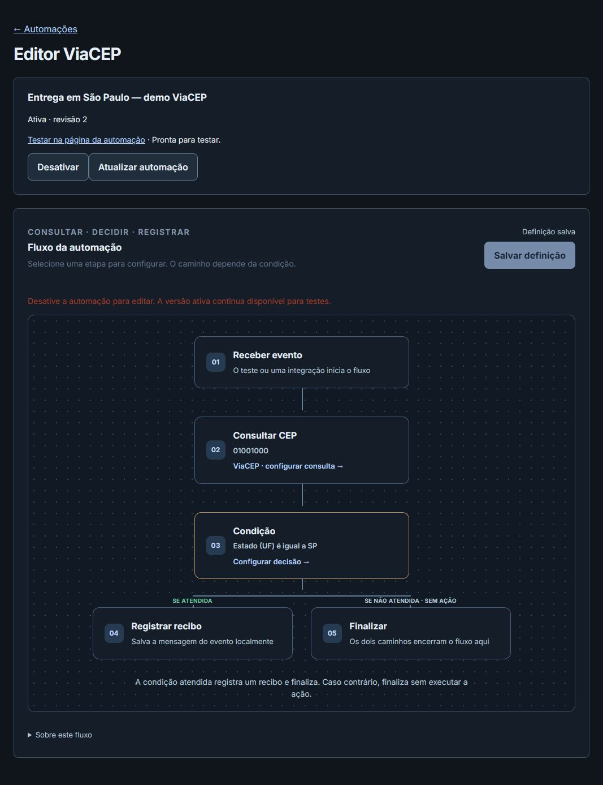
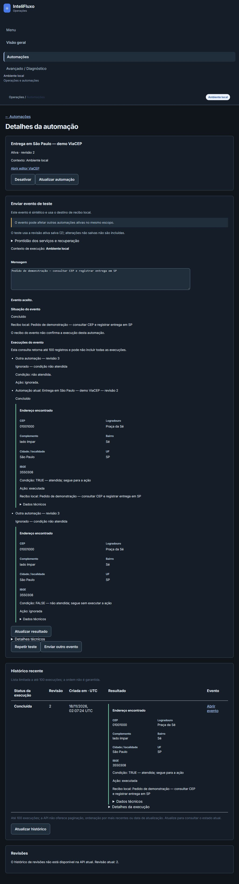

# Consulta ViaCEP: criar, executar e conferir

[Assistir ao vídeo guiado (53 segundos)](viacep-passo-a-passo.mp4)

O vídeo percorre capturas reais da interface durante uma execução local. É um tutorial com imagens e rolagem, sem áudio; não é uma gravação contínua. O resultado foi observado na API e na interface, sem fixtures ou resultados simulados.

## Preparação

Siga a instalação do [README](../../README.md#executar-localmente). A API, o relay, o worker, o scheduler, PostgreSQL e RabbitMQ devem estar prontos. Use somente dados sintéticos neste MVP local, que não tem autenticação ou isolamento entre usuários.

Para habilitar a consulta, configure os quatro gates abaixo no ambiente dos processos, ou no arquivo **ignorado pelo Git** `intelifluxo.local.json` na raiz, e reinicie o launcher:

```json
{
  "AUTOMATION_SNAPSHOTS_ENABLED": "true",
  "CONDITIONS_WRITES_ENABLED": "true",
  "VIACEP_WRITES_ENABLED": "true",
  "VIACEP_EXTERNAL_EXECUTION_ENABLED": "true"
}
```

Se já existir configuração local, acrescente os campos preservando as configurações de conexão. Não publique credenciais. O serviço ViaCEP precisa estar acessível por HTTPS; falhas de rede devem aparecer como falhas, sem fabricar endereço.

## Passo a passo pela interface

1. Abra `http://127.0.0.1:5173/#automations` e clique em **Criar automação**.
2. Escolha **Consultar CEP e decidir**, dê um nome e clique em **Criar desativada**.
3. No editor ViaCEP, selecione **Consultar CEP**. Confira **Origem do CEP: Fixo** e **CEP: 01001000**. Para entradas variáveis, escolha **Evento** e configure o campo do evento indicado pelo editor.
4. Selecione **Condição**. Use origem **Resultado da consulta**, campo **Estado (UF)** (`address.uf`), operador **É igual a**, tipo `string` e valor `SP`.
5. Se alterar valores, clique em **Aplicar ao rascunho** e **Salvar definição**. O template inicial já vem com esses valores salvos.
6. Clique em **Ativar** e confirme. A interface deve mostrar **Ativa** e **Pronta para testar**. Para editar novamente, desative primeiro.
7. Clique em **Testar na página da automação**, escreva uma mensagem sintética e clique em **Enviar evento de teste**.
8. Aguarde **Concluído**. Confira o resultado da **automação atual**, não apenas o aceite do evento. O histórico deve mostrar endereço encontrado, condição `TRUE`, ação executada e recibo local.



## Resultado comprovado

- Automação: `Entrega em São Paulo — demo ViaCEP`, revisão ativa 2.
- Evento: `88a1926d-fb68-417b-88b3-8762a6271d59`.
- CEP `01001000`: Praça da Sé, bairro Sé, São Paulo, UF `SP`.
- Condição `address.uf == "SP"`: atendida.
- Ação `record-receipt.v1`: executada, com a mensagem sintética persistida como recibo local.



## Limites do exemplo

A ação disponível registra um recibo local. Não envia WhatsApp, e-mail, pagamento ou pedido a um sistema externo. A chamada externa deste exemplo é a consulta pública ao ViaCEP.

O teste pode disparar **todas as automações ativas do mesmo contexto**. Na demonstração, duas outras automações receberam o evento e ignoraram a ação por condição não atendida. Nenhuma delas foi desativada ou alterada. Confira sempre a identificação da automação atual.

Se o endereço não satisfizer a condição, o caminho FALSE finaliza sem executar a ação. Um evento aceito ainda não comprova que o worker concluiu o fluxo: espere o estado terminal e confira o histórico.
