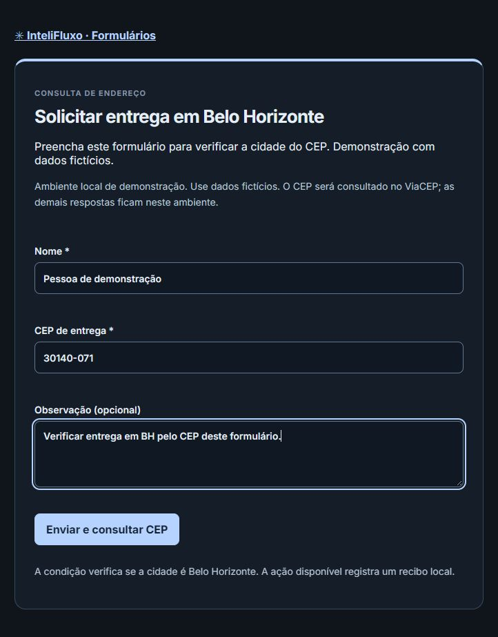
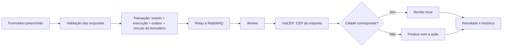
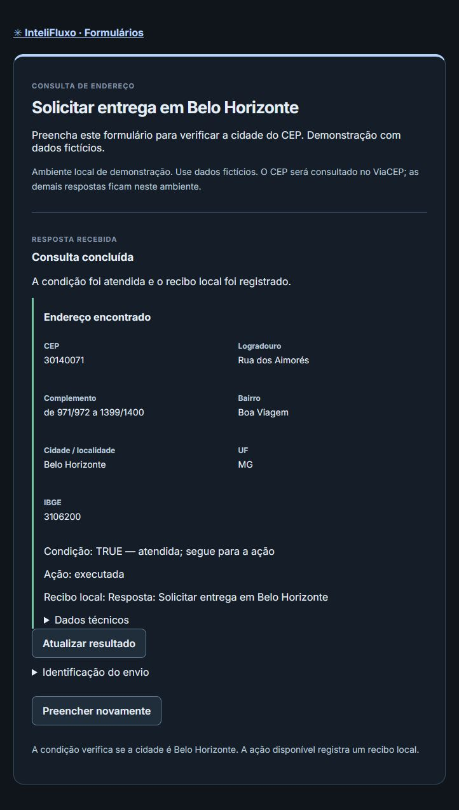
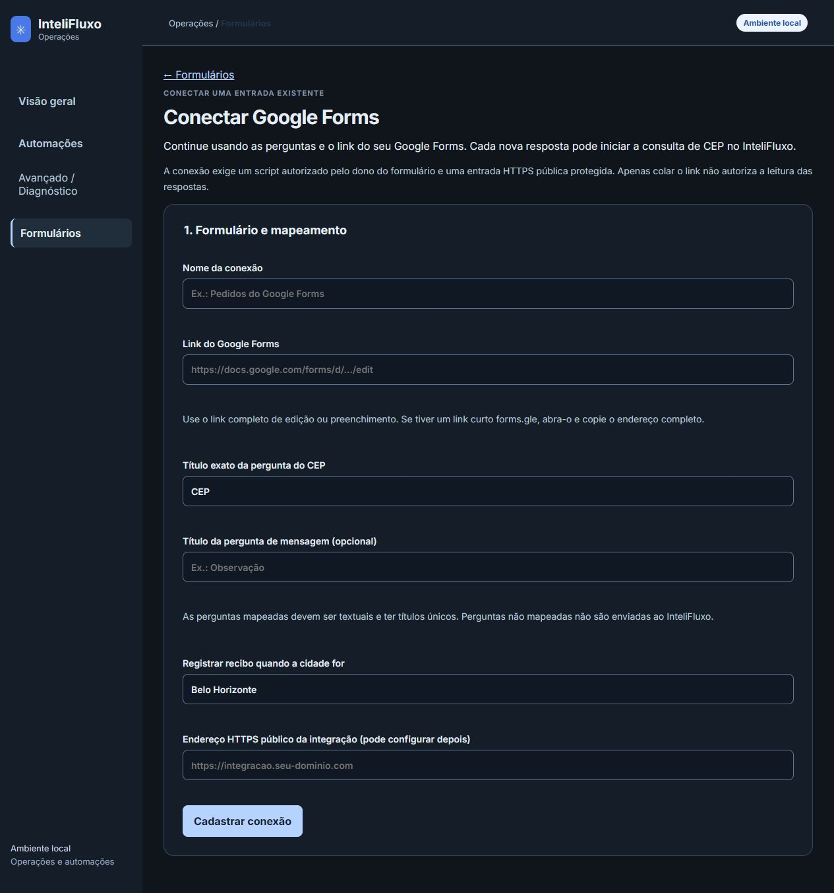

# Formulários que iniciam automações

Agora é possível criar vários formulários pela interface, sem alterar código para cada um. Cada formulário tem campos, título, descrição, cidade de decisão, link de preenchimento e histórico próprios. Os dados ficam no PostgreSQL e continuam disponíveis após reiniciar o app.

## Criar e usar

1. Abra **Formulários** no menu e clique em **Criar formulário**.
2. Preencha o título e a descrição. Altere os rótulos, remova campos opcionais ou adicione novos campos de texto curto, texto longo ou e-mail. O CEP obrigatório alimenta a consulta. São permitidos até 12 campos.
3. Em **Registrar recibo quando a cidade for**, informe o nome completo da cidade retornado pelo ViaCEP, como `Belo Horizonte`.
4. Clique em **Criar formulário**. Ele começa como rascunho e sua automação começa desativada.
5. Confira a prévia e clique em **Publicar formulário**. Isso ativa a automação vinculada.
6. Clique em **Abrir formulário**, preencha os campos com dados fictícios e envie. O CEP de cada resposta é enviado como `data.cep`; ele não é extraído do texto livre e não fica fixo no editor.
7. Aguarde o resultado. Se o endereço for da cidade configurada, a automação registra um recibo local. Caso contrário, finaliza pelo caminho FALSE sem executar essa ação.
8. Em **Respostas**, consulte os envios e abra seus resultados. A lista mostra até 100 respostas mais recentes. Os campos e a revisão do envio são preservados para não trocar os rótulos do histórico ao editar o formulário.
9. Para alterar um formulário publicado, clique em **Pausar recebimento**, edite, salve o rascunho e publique novamente. Respostas já aceitas continuam usando a revisão da automação selecionada no aceite.

## Fluxo de execução

Cada formulário recebe um contexto `form_<id>` diferente e uma automação ViaCEP própria. Criar um segundo formulário não compartilha o contexto do primeiro nem o contexto genérico `local`. Essa separação organiza os fluxos; não é isolamento de segurança entre usuários, pois o MVP não tem autenticação.

Criação, edição e publicação respeitam os gates de snapshots, escrita de condições e escrita ViaCEP. Publicar e enviar respostas também exigem execução externa ViaCEP habilitada. Os gates são os mesmos descritos no [tutorial ViaCEP](demo/README.md#preparação).

## Falhas, repetição e limites

- O envio usa identidade idempotente. Se a resposta HTTP for perdida, **Recuperar o mesmo envio** conserva o identificador e as respostas. Não cria outro evento com uma nova chave silenciosamente.
- A solicitação fica preservada na sessão da aba, inclusive após recarregar, quando o navegador permite armazenamento de sessão. Essa sessão contém as respostas: use dados fictícios neste MVP. Navegadores que bloqueiam o armazenamento mantêm apenas a recuperação em memória até fechar/recarregar.
- A recepção do evento e o vínculo com o formulário são uma única transação. Uma falha na gravação reverte ambos.
- Respostas com campos desconhecidos, campos obrigatórios ausentes, CEP inválido, e-mail inválido ou conteúdo acima dos limites são rejeitadas no servidor. Cada resposta textual tem até 500 caracteres, e os dados completos do evento continuam sujeitos ao limite de 4096 bytes.
- Uma versão desatualizada não é aceita silenciosamente. Recarregue antes de preencher novamente. Envios já aceitos podem ser recuperados mesmo após pausar o formulário.
- O resultado é consultado automaticamente por até cerca de um minuto. **Atualizar resultado** só consulta; não reenvia a resposta.
- Alterar a automação vinculada por fora do formulário pode interromper novos envios. Pause e publique novamente pelo formulário para restaurar a configuração correspondente.
- A ação implementada é um recibo local. Não envia e-mail, WhatsApp ou pedido a um serviço externo.

## Demonstração real

O formulário `Solicitar entrega em Belo Horizonte` foi criado, publicado e preenchido pela interface. CEP `30140-071`: Rua dos Aimorés, Boa Viagem, Belo Horizonte/MG. A condição retornou TRUE e a ação registrou o recibo local. Evento: `6f9bff6c-a7b2-4ed5-b0d9-2e98db68e234`.

## Acesso externo e Google Forms

Os links desta versão usam o endereço do ambiente local e funcionam neste computador. **Publicar formulário** significa permitir respostas dentro do app em execução; não publica uma aplicação na internet.

A área oferece dois caminhos: **Criar formulário** dentro do app e **Conectar Google Forms** para um formulário que o usuário já possui. Não é necessário cadastrar um formulário agora; as duas opções ficam disponíveis para novas conexões.

### Conectar um Google Forms existente quando tiver um

1. Abra **Formulários → Conectar Google Forms**.
2. Informe um nome, o link completo do Google Forms (edição ou preenchimento), o título exato da pergunta do CEP e a cidade da condição. Opcionalmente, mapeie uma pergunta de mensagem. As perguntas devem ser de texto curto ou parágrafo, com títulos únicos.
3. Cadastre a conexão. O endereço público pode ser configurado depois. Neste momento, o estado é **Aguardando configuração**: o link não concede acesso à conta nem às respostas.
4. Quando houver hospedagem/ponte HTTPS, informe a URL base pública. O proxy deve expor **somente** `POST /integrations/google-forms/<id>/submissions`, preservar `Authorization` e manter as demais rotas do MVP privadas. O cadastro e a geração do script não criam esse proxy ou hospedagem.
5. Clique em **Gerar script de integração** e baixe o arquivo `.gs`. Ele contém uma chave exclusiva: não publique o arquivo no Git, em logs ou capturas. O banco guarda somente o hash da chave; o código é apresentado apenas na geração. Gerar novamente invalida a chave anterior.
6. No editor do Google Forms, abra o Apps Script vinculado, cole o código e execute `instalarInteliFluxo`. O dono do formulário deve autorizar a conta. A instalação verifica as perguntas e evita criar o mesmo gatilho duas vezes.
7. Volte ao InteliFluxo e clique em **Ativar recebimento**. Envie uma resposta real pelo Google Forms.
8. Clique em **Atualizar estado**. **Recebeu resposta autenticada** significa que o endpoint recebeu e aceitou uma resposta com a chave correta; confira a conclusão da consulta em **Respostas e resultados**. O estado não afirma que houve OAuth direto entre o InteliFluxo e o Google.

O conector envia somente CEP e mensagem mapeados. Outras perguntas não são transmitidas. O identificador estável da resposta Google vira uma chave idempotente por conexão. Retentativas preservam o corpo; um identificador reutilizado com dados diferentes retorna conflito. O script faz até três tentativas para falhas de transporte/servidor. Se necessário, `reenviarRespostasRecentes` recupera até 20 respostas pelo formulário, com a mesma identidade. O Google continua guardando as respostas originais.

A conexão não usa scraping nem consulta a conta Google a partir de um link. Não importa o histórico automaticamente. Links curtos `forms.gle` devem ser abertos pelo usuário para copiar o endereço completo. Mudanças nos títulos das perguntas exigem ajustar o mapeamento/script; esta versão permite cadastrar uma nova conexão com o novo mapeamento e pausar a anterior.

### Estado de validação

Formulário nativo: execução real pela interface e consulta externa ViaCEP comprovadas acima. Conector Google: cadastro, geração do script, autenticação do webhook, repetição, revogação de chave e roteamento foram validados com testes locais e PostgreSQL isolado. O script foi executado em teste com as APIs Google simuladas. Nenhuma conta Google, formulário real ou hospedagem externa foi configurada nesta entrega; a autorização e o primeiro envio real ficam para quando o usuário possuir o formulário.

Referências oficiais: [gatilhos instaláveis](https://developers.google.com/apps-script/guides/triggers/installable), [eventos de envio do Forms](https://developers.google.com/apps-script/guides/triggers/events#google_forms_events) e [URL Fetch](https://developers.google.com/apps-script/reference/url-fetch).
